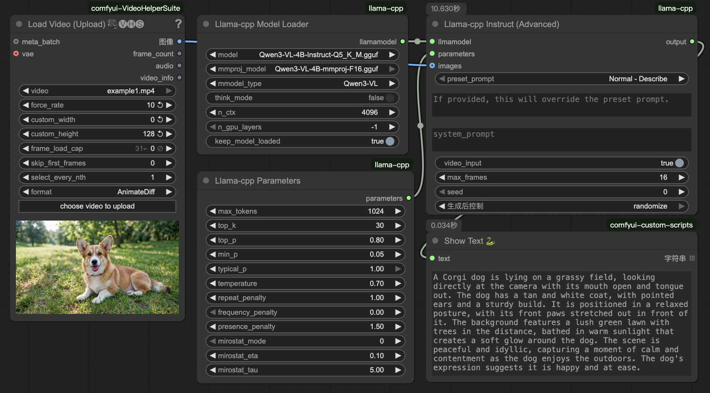

# ComfyUI-llama-cpp
在 ComfyUI 中基于 llama.cpp 框架原生运行 LLM & VLM 模型。  
**[[📃English](./README.md)]**   

## 预览


## 安装步骤

#### 安装节点:
```bash
cd ComfyUI/custom_nodes
git clone https://github.com/heyzne/comfyui-llama-cpp.git
python -m pip install -r ComfyUI-llama-cpp/requirements.txt
```

### 模型路径:
- 请将下载的 `.gguf` 模型放置在 `ComfyUI/models/LLM` 目录中.  

	> 在使用VLM模型进行图像推理之前, 请确保已经下载并选择了主模型对应的`mmproj`权重文件.

## 更新日志

#### v1.6.2
- **修复「输出退化成源视频描述」(关键修复)**: 优化 pass 之前会把源视频帧一并贴给 VLM, 模型看到原画面就直接复述一遍, 生成模式怎么写都没用。现在**源视频帧只用于反推, 不再送入优化 pass**, 优化 pass 只贴参考素材 (人物/背景), 源视频以文本形式作为「结构模板」注入。
- **源视频描述改为 `[Source Video Caption]` + `[Replacement Rule]`**: 明确声明源视频帧未附加、该描述只能作为结构模板 (时间线/运动/运镜/节奏/场景布局), 禁止复述; 参考素材块改名为 `[Reference Assets]`, 强调它是要「注入」目标视频的资产而不是源视频。
- **`[Rewrite Goal]` 改为三步替换流程**: ①只留结构 ②用参考素材替换主体/人物/服装/背景 ③按模式格式写成目标视频提示词。仅视频无参考素材时改为「保留结构并施加画面变化」, 不再凭空替换。
- **新增输出结构守卫 + 一次纠正重试**: H3 模式要求输出必须含 `[Shot N]` 段落或 `Audio:`/`Music:` 行; 若模型仍只输出素材描述, 自动追加 `[CORRECTION]` 指令重试一次, 把结果拉回 skill 模板结构。
- **主推理防退化**: 提示词优化开启时, 主推理会追加 `[Output Rule]`, 明确「上面的文本就是最终提示词, 直接输出, 不要重新描述附带素材」, 避免 `output` 也变成素材描述。
- **空提示词兜底分级**: 使用描述类预设且 `custom_prompt` 为空时, 按素材组合选择指令 — 视频+参考图→替换重写; 仅视频→保留结构并丰富画面; 仅图片→由图生视频续写。

#### v1.6.1
- **修复「选择生成模式没效果、输出只是原视频提示词」**: 根因是 `custom_prompt` 为空时会拿预设文本当优化源, 而 `Normal - Describe` 预设内容是 "Describe this @." → 模型只把原视频描述一遍。现在开启生成模式且使用描述类预设时, 改用默认的**替换重写指令**作为优化源 (非描述类预设不受影响)。
- **新增 `[Rewrite Goal]` 替换重写目标**: video 口 (源视频帧) 与 images/image_N (参考人物/背景) 同时连接时注入 — 保留源视频的时间线、运动、运镜、节奏与场景结构, **替换**原人物/背景为参考素材; 输出必须是目标视频提示词, 而非源视频描述。仅视频无参考素材时不注入。
- **Ref2VA 模板强化替换语义**: 新增 "REPLACEMENT, NOT DESCRIPTION" 条款, 禁止输出 `##Prompt##` 式标题, 并明确不得复述源视频样貌。

#### v1.6.0
- **新增 `风格技能` 下拉 (中文, 源自 MiniMax 官方 H3 skills 包的 8 个风格生成器)**: `自动` + 3D动画短片 / 品牌宣传视频 / 合作游戏开场 / 手绘实拍融合 / 极简产品广告 / 音乐视频字幕 / 纸拼贴解说 / 纸艺定格解说。`自动` 按用户提示词关键词匹配 (无命中不注入); 指定技能时注入其风格要义 (视觉风格锁/制作重点/一致性规则) 到优化请求, 输出结构仍遵循所选生成模式的 H3 skill。仅 H3 模式生效。
- **生成模式新增 `H3 - 自动`**: 按输入素材自动推断任务模式 (参考 ComfyUI-MiniMax-H3-Promptor 的 task_type=Auto): 无素材→T2VA, 1图→I2VA, 2图→FL2VA, 3图以上→Ref2VA, 仅 video口→V2V, 视频+参考图→Ref2VA。
- **生成模式新增 `H3 - 视频生视频 (V2V)`**: video 口帧视为源视频 <Video 1>, 按其运镜/节奏/分镜结构套用所请求的视觉更改。

#### v1.5.4
- **H3 skill 全面替换为官方格式**: 参考 [ComfyUI-MiniMax-H3-Promptor](https://github.com/1038lab/ComfyUI-MiniMax-H3-Promptor) (GPL-3.0) 所用的 MiniMax H3 官方 skill 结构重写 (独立实现, 未逐字复制)。新输出格式: 定时 `[Shot 1]...[Shot N] At MM:SS.mmm` 段落 + 结尾 `Audio:` / `Music:` 两行, **不再使用** integrated_multimodal_description / 六段式字段头。
  - 导演底座: 群像编排与题材自适应、前景/中景/背景同框空间调度、按时长的分镜预算 (4-6s: 1-2 镜; 7-10s: 2-3 镜; 11-15s: 3-5 镜)、动作衔接转场、官方对白语法 `<Subject N> (SN) ... says: <d>[Language] "..."</d>`、镜头术语表 (含振幅/速度)、屏幕文字双引号规则。
  - 五种模式各自的任务模板: T2VA / I2VA (首帧对齐) / FL2VA (首尾帧对齐 + 该模式专用的无尖括号规则) / L2VA (尾帧对齐) / Ref2VA (全参考角色/动作迁移, 定义 <Subject N> 标签, 风格句在 [Shot 1] 之前)。
  - 无背景音乐 → 结尾 `Music: N/A`; 格式优先规则同步更新为新输出结构。
  - 旧字段 (integrated_multimodal_description / overall_soundscape / non_diegetic_music / 六段式) 相关的输出格式表已移除。

#### v1.5.3
- **修复优化输出不遵循 skill 格式的问题**: 用户提示词只是**内容引导**, 输出结构必须严格按所选生成模式的 skill 规范。新增 `[Output Format Rule]` (格式优先规则): 即使用户引导词里自带格式要求 (镜头列表/时间戳样式/段落标题等), 也绝不照搬为输出骨架, 用户的内容要求 (镜头运动/色调/光线/景别/时长等) 一律重组进 skill 要求的字段; Ref2VA 强制六段式 (subject_definitions/summary/retention_analysis/detailed_description/overall_soundscape/non_diegetic_music), 其它 H3 模式强制三字段; 禁止 "Based on the provided images..." 之类前言。

#### v1.5.2
- **新增 `image + video` 推理模式**: 同时连接 video 口(视频帧序列) 与 images/image_N(独立参考图) 时使用。视频部分按 `max_frames` 均匀采样并做整体反推, 图片部分全部保留并逐张反推; 优化请求中参考标签自动对齐 (视频帧在前, 图片标签从其之后开始编号)。`video` 模式下若混接图片, 图片也不再被当作视频帧采样。

#### v1.5.1
- **性能修复**: 优化阶段反推的帧数上限在所有模式下统一为 8 帧。此前 `one by one` / `images` 模式会逐帧全量反推 (长视频可达数百次调用, 极其耗时); 现在超过 8 帧时均匀采样 8 帧做反推与优化参考。主推理仍按所选模式处理全部帧 (`one by one` 逐张 / `video` 按 max_frames 采样)。

#### v1.5.0
- **video 输入口类型改为 IMAGE**: `Llama-cpp Instruct` 的 `video` 端口由 VIDEO 类型改为 IMAGE 类型, 可直接连接视频加载节点输出的帧序列 (如截图中的 AnimateDiff 加载器「图像」输出)。配合 `推理模式=video` 使用时, 提示词优化前会先对视频整体反推 (采样≤8 帧描述动作/运镜/时间变化)。与 images/image_N 同时连接时视频帧排在图片之后。

#### v1.4.9
- **新增 VIDEO 视频输入口**: `Llama-cpp Instruct` 节点新增 `video` 输入端口, 可直接连接 Load Video / VHS 等视频源节点。自动抽取全部帧并入图片流水线; 配合 `推理模式=video` 使用时, 提示词优化前会先对视频整体反推 (采样≤8 帧)。与 images/image_N 同时连接时视频帧排在图片之后。旧工作流不受影响。

#### v1.4.8
- **新增视频反推**: 推理模式为 `video` 且连接多帧时, 提示词优化前先将输入帧视为**一段视频**整体反推 (均匀采样最多 8 帧, 单次调用描述主体动作/运镜/时间变化), 反推描述以 `[Reference Video]` 块注入优化请求; 上下文不足时自动 8→4→2 帧减帧重试, 最终兜底纯文本优化。图片模式逐张反推行为不变。
- **max_tokens 上限放开**: `Llama-cpp Parameters` 的 `max_tokens` 上限由 4096 提升至 32768。

#### v1.4.7
- **移除 `输出语言` 参数**: 模型经常无视系统提示词中的输出语言指令 (skill 规范本身是英文), 该控件无法可靠控制输出语言, 故删除。
  - 现在优化结果**固定为中英双语**: 英文版 (skill 规范原生语言, 遵循度最好) 用于主推理, 中文版由独立翻译 pass 生成、便于查看, 一并从 `optimized_prompt` 输出。
  - 翻译 pass 若因上下文不足失败, 自动降级为仅输出英文版, 不中断流程。
  > ⚠️ 参数移除会使旧工作流中该项设置失效 (节点结构不受影响)。若希望节省一次翻译推理只输出英文, 可再反馈加回开关。

#### v1.4.6
- **修复主推理 decode 溢出**: 解决 `Llama.eval(decode): Failed completely even with batch size 1.` (优化后长提示词 + 图片 + 输出 token 超出 n_ctx 导致 KV cache 写满)。
  - 主推理 (含 `one by one` 逐张模式) 同样按上下文预算选择图片边长, 溢出时逐级缩小重试 (1024→768→512→384→256)。
  - 新增**输出 token 预算收窄**: 按 `n_ctx - 提示词 - 余量` 自动降低 `max_tokens`, 避免生成阶段再次撑爆; 提示词不长时完全不改动。
  - 错误识别统一: `Multimodal chunk exceeded context limit` 与 `Failed completely even with batch size 1` 都判定为上下文类, 才触发降级; 其他错误 (如显存不足) 照常抛出。
  > 根本解法仍是调大 `Llama-cpp Model Loader` 的 `n_ctx` (多图 + Qwen 系建议 16384 以上), 降级只是保底。

#### v1.4.5
- **修复上下文溢出崩溃**: 解决 `Qwen35ChatHandler: Multimodal chunk exceeded context limit (n_ctx=8192)` 报错。提示词优化 pass 现按上下文预算自动选择参考图边长 (1024→768→512→384→256), 失败时逐级缩小重试; 仍放不下则退回纯文本优化 (保留反推描述); 单张反推失败会跳过而不中断整体流程。
  > 估算依据: 中日韩字符 ~1 token/字, 其余 ~4 字符/token, 视觉约 28px/token (Qwen-VL 系)。优化请求的 max_tokens 也会按剩余空间自动收窄, 避免输出阶段再次溢出。
  > 若仍报上下文不足, 请在 `Llama-cpp Model Loader` 节点调大 `n_ctx`, 或减少参考图数量 / 缩短提示词。

#### v1.4.4
- **用户意图优先**: 修复优化器忽略自定义提示词动作的问题 (如输入 "唱着歌曲" 但参考图是弹琵琶, 优化结果丢失唱歌)。优化请求现注入 [Priority Rule]: 用户提示词是首要创作意图, 其描述的动作/事件 (唱歌、跳舞、对话等) 即使参考图中不可见或与画面矛盾, 也必须保留在优化结果中; 参考图仅提供外观/服装/道具/场景/风格。
- **参数中文化**: `generation_mode` / `output_language` / `no_bgm` 更名为 `生成模式` / `输出语言` / `无背景音乐`。
  > ⚠️ 参数名变更会使旧工作流中这三项的已保存值重置为默认 (生成模式=None), 重新选择一次即可。

#### v1.4.3
- **移除提示词优化的后台打印**: 不再向控制台/后台输出优化后的完整提示词及各阶段进度日志 (优化结果仍从 `optimized_prompt` 输出口获取).
  > 仅保留一条提示: 当预设含 `*` 占位符 (检测类预设) 导致优化被跳过时会说明原因.

#### v1.4.2
- **提示词优化增强**: 选择 `generation_mode` 且连接参考图时, 优化前先逐张**反推**参考图内容, 反推描述与自定义提示词一并交给对应 skill 改写, 生成规范的编辑提示词 (自动将 "图1/图2" 等序数词引用映射为 `<image1>/<image2>` / `<Picture N>` 标准标签).
  > 示例: 输入 "图1的女人坐在图2的黄色沙发上" + 2 张参考图 → 优化器结合两张图的反推内容, 输出符合 Qwen-Image-2.1 编辑规范的提示词.

#### v1.4.1
- **精简节点**: 移除 `Llama-cpp Clean States` / `Llama-cpp Image Recognition` / `Llama-cpp Dynamic Image Switch` 及独立提示词优化节点 (功能已内置于 Instruct 节点).
  > 提示词优化请直接使用 `Llama-cpp Instruct` 节点的 `generation_mode` / `output_language` / `no_bgm` 参数, 优化结果从新增的 `optimized_prompt` 输出口获取.

#### v1.4.0
- **新增提示词优化**: Instruct 节点内置 MiniMax-H3 / Qwen-Image-2.1 专用提示词优化 (generation_mode, 默认 None 关闭), 支持中英文输出, 优化后的提示词通过新增的 `optimized_prompt` 输出口输出.
- **新增独立提示词优化节点** (`Llama-cpp Prompt Optimizer`): 仅优化不推理, 输出 english_prompt / chinese_prompt.
- 参考 [ComfyUI-xiaozhuguang](https://github.com/xiaozhuguang/ComfyUI-xiaozhuguang) (MIT) 移植.

#### v1.2.9
- 新增 Qwen3.8 / Qwen3.8-Thinking 支持 (含 27B), 支持思考模式开关; 旧版 llama-cpp-python 自动回退到 Qwen35 兼容处理器.
  > 注意: Qwen3.8 的模型架构需要 2026-08-14 之后构建的 llama.cpp / llama-cpp-python, 请安装最新的 [JamePeng 轮子](https://github.com/JamePeng/llama-cpp-python/releases)或自行编译.
- 修复动态图片接口: 拔掉 image_2 后不再错误出现 image_3; 增删接口不再导致节点 UI 变窄; 自动清理旧工作流遗留的 image / queue_handler 接口.
- 移除 queue_handler 接口.
- 新增自动卸载显存/内存: 其他模型加载到 GPU 时, 剩余显存低于阈值 (加载器节点可调, 默认 2GB) 自动卸载 LLM.

## 致谢
- [llama-cpp-python](https://github.com/JamePeng/llama-cpp-python) @JamePeng  
- [ComfyUI-llama-cpp](https://github.com/kijai/ComfyUI-llama-cpp) @kijai
- [ComfyUI](https://github.com/comfyanonymous/ComfyUI) @comfyanonymous
